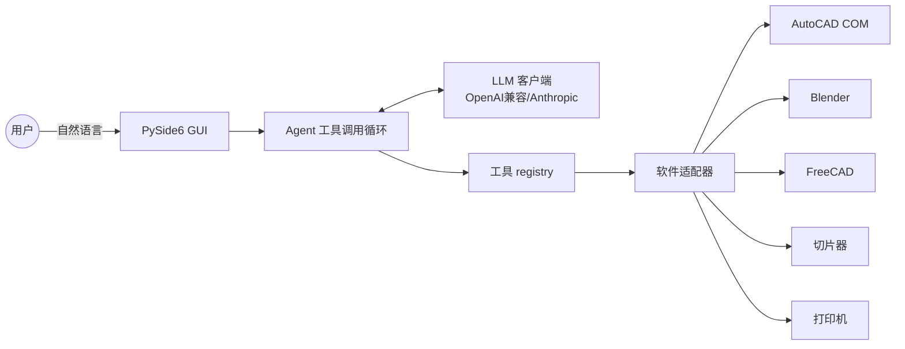

# 🤖 AI CAD Studio

> 一款资深、高效、美观、功能完整的 **AI 连接自动化设计工具**，让 AI 助手直接控制 AutoCAD、3D 制作与打印软件，在 Windows 上实现智能自动化的设计工作流。


-41CD52)


---

## 📌 项目简介

**AI CAD Studio** 是一个集成 AI 助手的开源桌面工具。它把主流大语言模型（LLM）与工程/设计软件连接起来，通过 **Function Calling（工具调用）Agent 循环**，让你用自然语言指挥 AI 完成制图、建模、切片与 3D 打印等任务。

你只需在聊天框里说一句"在 AutoCAD 里画一个 100×60 的矩形并标注"，AI 就会自动生成并执行对应的软件指令，把结果回传给你确认。无需记忆复杂的软件命令，也无需手写脚本。

---

## 🎯 需求背景

用户希望拥有一款能真正"干活"的 AI 设计工具，而非只能聊天的对话机器人。核心诉求如下：

- **集成 AI 助手**：内置可切换的 AI 模型/Agent，支持多提供商。
- **模型可自由选择**：用户通过 API Key 连接自己选定的 AI 模型/Agent。
- **打通设计软件**：AI 能够直接调用 **AutoCAD、主流 3D 制作软件（Blender、FreeCAD）、3D 打印软件、图纸设计软件**。
- **实现 AI 控制与设置**：不仅生成建议，更能实际操控软件、执行命令、完成配置。
- **产品品质要求**：资深、高效、美观、功能完整、用户体验友好。
- **运行环境**：可在 **Windows** 平台完整运行。

AI CAD Studio 正是为满足上述目标而设计。

---

## ✨ 功能特性

- 🧠 **多模型支持**：内置 7 类 AI 提供商，界面内自由切换提供商与模型。
- 🔌 **工具调用 Agent**：基于 Function Calling 的自动循环，最多 10 轮迭代直到任务完成。
- 🖥️ **原生桌面 GUI**：PySide6 (Qt6) 深色主题，美观且对 Windows 友好。
- 📐 **AutoCAD 自动化**：COM 接口直连，画直线/圆/多段线/文字、图层管理、执行命令与 AutoLISP。
- 🧊 **Blender 建模渲染**：自动运行 AI 生成的 `bpy` 脚本完成建模与渲染。
- 🛠️ **FreeCAD 参数化建模**：执行 FreeCAD 脚本，导出 STEP / STL。
- 🍰 **切片能力**：调用 PrusaSlicer / CuraEngine 将 STL 切片为 G-code。
- 🖨️ **3D 打印控制**：通过 OctoPrint REST API 或串口直连发送 G-code。
- 💾 **本地配置**：API Key 与软件路径等全部保存在本地用户目录。
- 🚀 **一键启动 / 打包**：`run.bat` 自动建虚拟环境装依赖；`build_exe.bat` 打包独立 exe。

---

## 🤝 支持的 AI 提供商

| 提供商 | 标识 | 类型 | 配置方式 |
| --- | --- | --- | --- |
| OpenAI | `openai` | 云端 | API Key + Base URL |
| DeepSeek | `deepseek` | 云端 | API Key + Base URL |
| Moonshot (Kimi) | `moonshot` | 云端 | API Key + Base URL |
| 智谱 GLM | `glm` | 云端 | API Key + Base URL |
| Anthropic Claude | `anthropic` | 云端 | API Key + Base URL |
| Ollama | `ollama` | 本地 | 本地服务地址（无需 Key） |
| 自定义 OpenAI 兼容端点 | `custom` | 云端/本地 | API Key + 自定义 Base URL |

> 所有云端提供商均通过 **API Key + Base URL** 配置，可在设置对话框中随时切换提供商与模型。

---

## 🎨 支持的设计软件

| 软件 | 适配器 | 连接方式 | 典型用途 |
| --- | --- | --- | --- |
| AutoCAD | `autocad` | Windows COM 自动化 | 2D 制图、图元查询、命令/AutoLISP 执行 |
| Blender | `blender` | `blender.exe --background --python` | 3D 建模、渲染 |
| FreeCAD | `freecad` | `FreeCADCmd.exe` 脚本 | 参数化建模、导出 STEP/STL |
| 切片器 | `slicer` | PrusaSlicer / CuraEngine CLI | STL → G-code |
| 3D 打印机 | `printer` | OctoPrint REST API / 串口 | 上传、开始打印、状态查询 |

---

## 🏗️ 架构简图



```text
┌────────────┐    ┌──────────────┐    ┌──────────────┐    ┌─────────────────┐
│  PySide6   │───▶│  Agent 循环   │◀──▶│  LLM 客户端   │    │  工具 registry   │
│    GUI     │    │ (≤10 轮)     │    │ OpenAI/Anth. │    └────────┬────────┘
└────────────┘    └──────┬───────┘    └──────────────┘             │
                         │ tool_calls                               ▼
                    ┌────┴──────────────────────────────────────────────┐
                    │         软件适配器 (adapters/)                       │
                    │  AutoCAD │ Blender │ FreeCAD │ 切片 │ 打印机          │
                    └─────────────────────────────────────────────────────┘
```

---

## 🚀 快速开始

### 方式一：一键启动（推荐）

确保已安装 **Python 3.10+**，然后双击或在命令行运行：

```bat
run.bat
```

`run.bat` 会自动创建虚拟环境、安装 `requirements.txt` 依赖并启动程序。

### 方式二：手动启动

```bat
pip install -r requirements.txt
python main.py
```

### 方式三：打包为独立 exe

```bat
build_exe.bat
```

使用 PyInstaller 打包为可独立运行的 `.exe`，无需 Python 环境。

---

## ⚙️ 配置说明

程序配置保存在本地文件：

```text
%USERPROFILE%\.ai-cad-studio\config.json
```

主要配置项：

| 配置项 | 说明 |
| --- | --- |
| `provider` | 当前 AI 提供商（如 `openai`、`deepseek`） |
| `api_key` | 对应提供商的 API Key |
| `base_url` | API Base URL（自定义端点或代理地址） |
| `model` | 选用的模型名称 |
| `software_paths` | 各软件可执行文件路径（AutoCAD / Blender / FreeCAD / 切片器） |
| `printer` | 打印机连接信息（OctoPrint 地址与 Key 或串口） |

在图形界面的 **设置对话框** 中即可完成上述全部配置，无需手动编辑文件。

---

## 💡 使用示例

- **AutoCAD 制图**：`在 AutoCAD 里画一个 100x60 的矩形并标注`
- **Blender 建模**：`用 Blender 建一个茶壶并渲染，输出 PNG 图片`
- **FreeCAD 建模**：`用 FreeCAD 参数化建一个 M8 六角螺母并导出 STEP`
- **切片**：`把 model.stl 用 0.2mm 层高切片`
- **打印**：`把 model.stl 切片并发送到打印机`

---

## ⚠️ 安全注意事项

- 🔐 **API Key 本地存储**：所有密钥仅保存在本机 `%USERPROFILE%\.ai-cad-studio\config.json`，不会上传到任何第三方服务器。请妥善保管该文件，避免泄露。
- ⚡ **AI 生成脚本执行风险**：AI 可能生成并执行 Python 脚本（Blender/FreeCAD）或 AutoLISP / AutoCAD 命令。请仅在可信环境下使用，并建议先在测试图纸/模型上验证结果，再应用到正式工程。
- 🖥️ **软件操控范围**：本工具会直接操控你本地的设计软件，执行命令与文件写入操作，请确认已备份重要文件。
- 🌐 **网络请求**：仅向你所配置的 AI 提供商与本地打印机发起网络请求。

---

## 📄 许可证

本项目基于 **MIT License** 开源。详见仓库 `LICENSE` 文件。

---

<p align="center">Made with ❤️ for designers & makers on Windows</p>
