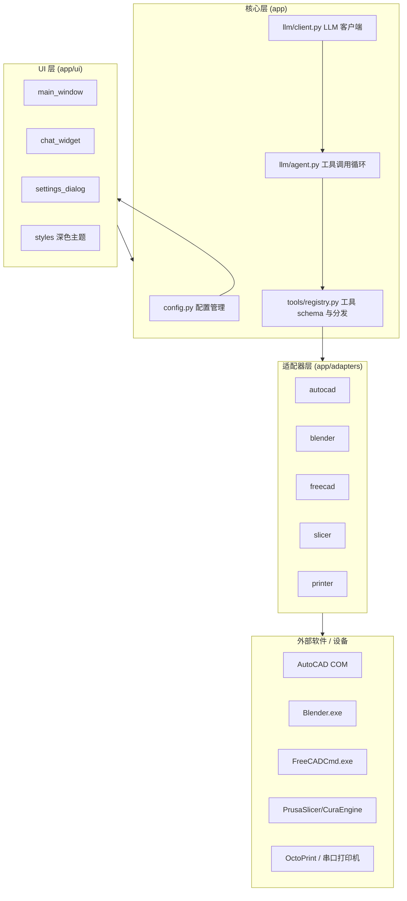
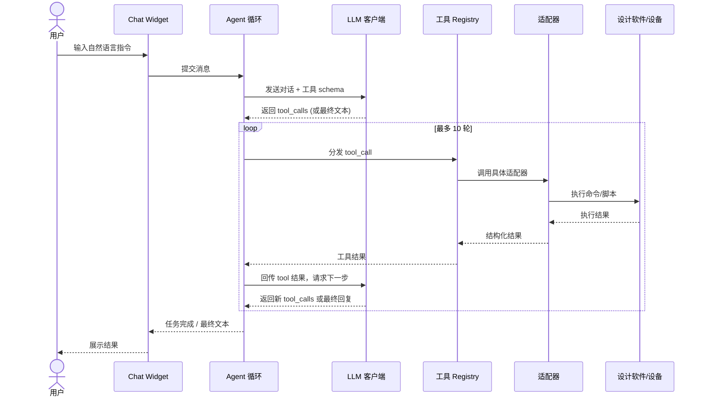

# 🏗️ AI CAD Studio 架构文档

本文档说明 AI CAD Studio 的内部架构、模块分层、Agent 工具调用流程，以及各软件适配器的实现原理与扩展方式。

---

## 1. 模块分层图



### 目录结构

```text
ai-cad-studio/
├── main.py                 入口
├── app/
│   ├── config.py           配置管理
│   ├── llm/
│   │   ├── client.py       LLM 客户端 (OpenAI 兼容 + Anthropic)
│   │   └── agent.py        工具调用 Agent 循环
│   ├── tools/
│   │   └── registry.py     工具 schema 与分发
│   ├── adapters/           各软件适配器
│   │   ├── autocad/
│   │   ├── blender/
│   │   ├── freecad/
│   │   ├── slicer/
│   │   └── printer/
│   └── ui/                 PySide6 界面
│       ├── main_window/
│       ├── chat_widget/
│       ├── settings_dialog/
│       └── styles/
├── docs/                   文档
├── run.bat
├── build_exe.bat
└── requirements.txt
```

---

## 2. Agent 工具调用时序

AI CAD Studio 的核心机制是 **Function Calling 工具调用 Agent 循环**：模型返回 `tool_calls`，应用执行对应适配器并把结果回传模型，循环直到任务完成（**最大 10 轮**）。



**关键约束**：单轮对话内 Agent 循环上限为 **10 轮**，超出后强制返回当前已获结果并提示用户。

---

## 3. 各适配器实现原理

### 3.1 AutoCAD 适配器（Windows COM 自动化）
- 通过 `pywin32` 创建/获取 `AutoCAD.Application` COM 对象。
- 支持操作：画直线 / 圆 / 多段线 / 文字、图层管理、执行任意 AutoCAD 命令与 AutoLISP、查询图元、缩放视图、保存图纸。
- 适用于已安装并运行 AutoCAD 的 Windows 环境。

### 3.2 Blender 适配器
- 将 AI 生成的 `bpy` Python 脚本写入临时文件。
- 调用 `blender.exe --background --python script.py` 在后台执行建模 / 渲染任务。
- 适合无界面、自动化的批量建模与出图。

### 3.3 FreeCAD 适配器
- 通过 `FreeCADCmd.exe` 执行 AI 生成的 FreeCAD Python 脚本。
- 支持参数化建模，并可导出 STEP / STL 等格式供后续切片。

### 3.4 切片适配器
- 调用 **PrusaSlicer** 或 **CuraEngine** 命令行，将 STL 模型切片为 G-code 文件。
- 切片参数（层高、填充率等）可由 AI 通过工具参数传入。

### 3.5 3D 打印机适配器
- **OctoPrint**：通过 REST API 实现上传 / 开始打印 / 状态查询。
- **串口直连**：通过 `pyserial` 直接发送 G-code 指令到打印机。

---

## 4. 扩展新适配器的步骤指南

要新增一款受控软件（例如 Fusion 360、SolidWorks 等），按以下流程操作：

1. **创建适配器目录**：在 `app/adapters/` 下新建子目录（如 `fusion/`），实现软件连接与操作封装（命令调用 / 脚本执行 / API 请求）。
2. **定义工具 schema**：在 `app/tools/registry.py` 中为新能力声明 JSON Schema（名称、参数、描述），供 LLM 理解如何调用。
3. **注册分发逻辑**：在 registry 中将工具名映射到对应适配器函数。
4. **补充 UI 配置项**（如需要）：在 `settings_dialog` 与 `config.py` 中增加软件路径 / 连接参数配置。
5. **编写提示词示例**：为 Agent 提供该软件的典型用法说明，提升调用准确率。
6. **测试**：在 `chat_widget` 中发送相关指令，验证最多 10 轮内可完成任务并获得正确回传。

> 设计原则：每个适配器只负责**单一软件的连接与执行**，工具 schema 与分发集中在 registry，保持核心循环与界面解耦，便于维护与扩展。
